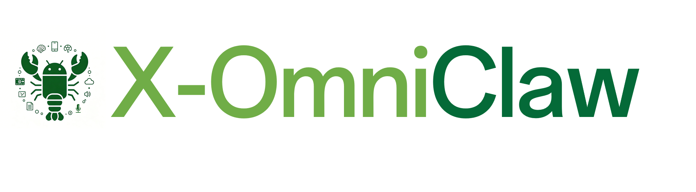
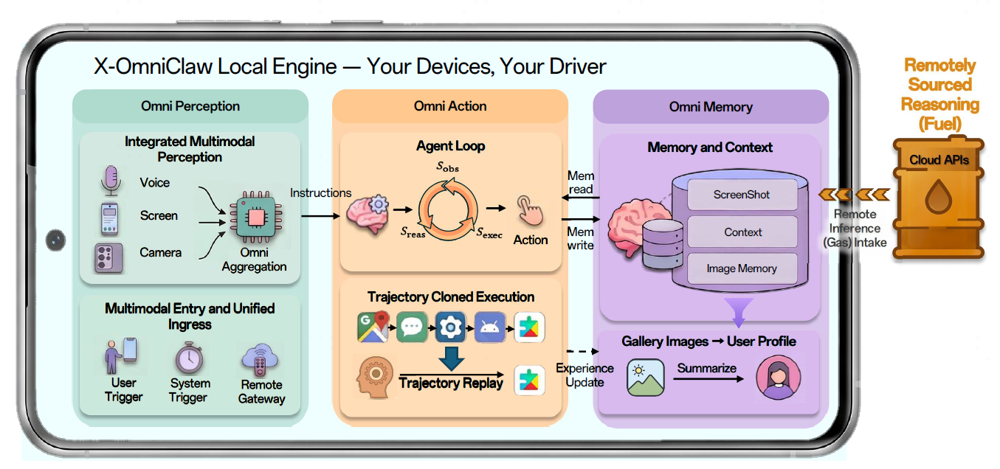

<div align="center">
  
  <p>
    <a href="https://github.com/OPPO-Mente-Lab/X-OmniClaw/releases/latest"></a>
    <a href="https://www.android.com/"></a>
    <a href="https://github.com/OPPO-Mente-Lab/X-OmniClaw/blob/main/LICENSE"></a>
    <a href="assets/main.pdf"></a>
  </p>
</div>

作为一个集语音、视觉与动作于一体的 **安卓原生智能体**，**X-OmniClaw** 的定位是「可执行的图形界面引擎」。它不依赖虚拟环境，而是直接在真机上沿「感知-执行-优化」的逻辑循环推进。

**Omni** 意味着全方位的感知能力——系统不仅关注屏幕内的像素，还关注屏幕外的物理上下文；而 **X-** 则赋予系统跨模态的整合能力。这种架构将碎片化的数据整合为统一的意志，确保智能体能够像人类一样，在真实的移动端生态中自主、可靠地完成任务闭环。

本文（中文） · [English 英文](README_EN.md)

**[🧭 概览](#overview) | [💡 核心特性](#key-features) | [🎬 使用场景与录屏](#use-cases-demo) | [🔧 技能与工具](#skills-tools) | [🤖 模型](#models) | [🚀 快速开始](#quick-start) | [🛠️ 源码构建](#build-from-source) | [📄 许可证](#license) | [🙏 致谢](#acknowledgments)**

---

## 📢 动态

- **2026-04-22** 🧠 执行策略收敛：确立「纯文本可本地直返、凡设备操作统一走智能体」的主路径，并增强跨包 `ref` 安全重绑定与错误定位日志。
- **2026-04-20** 🧵 多会话并行落地：会话级独立智能体主循环、跨会话运行态隔离与精确停止链路上线，显著提升长任务稳定性。
- **2026-03-31** ⏰ 定时自动化可用：支持按间隔、工作日或周计划执行任务，覆盖息屏与亮屏场景。
- **2026-03-25** 🎙️ 语音视觉主链路成型：本地语音视觉闭环（录音、视觉帧、决策与执行）打通，语音与文本进入统一执行核心。
- **2026-03-14** 🛠️ 核心运行时重构：统一设备工具落地（快照、操作、打开应用、截图等），并对齐 OpenClaw 关键运行时能力。

---

<a id="overview"></a>
## 🧭 概览



**X-OmniClaw** 定位为面向智能手机的 **全模态移动 Agent**：不依赖虚拟环境，在真机上沿 **感知 → 策略 → 执行 → 验收** 闭环推进。下文用表格归纳其 **执行型方法论**、**四层架构** 与 **三大全模态支柱**。

### 1. 核心方法论：从「对话」转向「执行」

X-OmniClaw 遵循 **循环递归推理** 模型，确保在复杂移动端 GUI 环境下的任务达成。

<!-- 概览三张表：均为 3 列，列宽 14% / 24% / 62%，table 样式与 colgroup 完全一致（GitHub 上纯 Markdown 表无法固定列宽） -->
<table style="width:100%; border-collapse:collapse; border:1px solid #d0d7de; table-layout:fixed; margin-bottom:12px;">
<colgroup>
<col style="width:14%">
<col style="width:24%">
<col style="width:62%">
</colgroup>
<thead>
<tr style="background:#f6f8fa; border-bottom:1px solid #d0d7de;">
<th align="left" style="padding:8px 12px;">环节</th>
<th align="left" style="padding:8px 12px;">标识 (Action)</th>
<th align="left" style="padding:8px 12px;">描述</th>
</tr>
</thead>
<tbody>
<tr style="border-bottom:1px solid #eef1f4;"><td style="padding:8px 12px; vertical-align:top;">观察</td><td style="padding:8px 12px; vertical-align:top;"><strong>Observe</strong></td><td style="padding:8px 12px;">通过系统快照、实时截图或无障碍树（Accessibility Tree）获取当前界面状态。</td></tr>
<tr style="border-bottom:1px solid #eef1f4;"><td style="padding:8px 12px; vertical-align:top;">思考</td><td style="padding:8px 12px; vertical-align:top;"><strong>Think</strong></td><td style="padding:8px 12px;">结合用户目标、当前上下文与历史动作记录，由 LLM/VLM 做出决策。</td></tr>
<tr style="border-bottom:1px solid #eef1f4;"><td style="padding:8px 12px; vertical-align:top;">执行</td><td style="padding:8px 12px; vertical-align:top;"><strong>Act</strong></td><td style="padding:8px 12px;">调度底层驱动执行点击、滑动、文本输入或应用切换等原子动作。</td></tr>
<tr style="border-bottom:1px solid #eef1f4;"><td style="padding:8px 12px; vertical-align:top;">验证</td><td style="padding:8px 12px; vertical-align:top;"><strong>Verify</strong></td><td style="padding:8px 12px;">动作完成后重新捕获界面，对比预期结果与实际状态。</td></tr>
<tr><td style="padding:8px 12px; vertical-align:top;">循环</td><td style="padding:8px 12px; vertical-align:top;"><strong>Loop</strong></td><td style="padding:8px 12px;">若任务未完成，将新状态作为下一轮输入；若已达成，则结束任务。</td></tr>
</tbody>
</table>

### 2. 系统技术架构：四层闭环驱动

系统采用模块化设计，通过「感知 $\rightarrow$ 策略 $\rightarrow$ 执行 $\rightarrow$ 验收」实现全链路闭环。

<table style="width:100%; border-collapse:collapse; border:1px solid #d0d7de; table-layout:fixed; margin-bottom:12px;">
<colgroup>
<col style="width:14%">
<col style="width:24%">
<col style="width:62%">
</colgroup>
<thead>
<tr style="background:#f6f8fa; border-bottom:1px solid #d0d7de;">
<th align="left" style="padding:8px 12px;">架构层</th>
<th align="left" style="padding:8px 12px;">核心组件</th>
<th align="left" style="padding:8px 12px;">职责定义</th>
</tr>
</thead>
<tbody>
<tr style="border-bottom:1px solid #eef1f4;"><td style="padding:8px 12px; vertical-align:top;">感知层</td><td style="padding:8px 12px; vertical-align:top;"><strong>Multi-modal Input</strong></td><td style="padding:8px 12px;">融合语音识别（ASR）、截图/录屏帧、无障碍树信息，构建统一感知上下文。</td></tr>
<tr style="border-bottom:1px solid #eef1f4;"><td style="padding:8px 12px; vertical-align:top;">策略层</td><td style="padding:8px 12px; vertical-align:top;"><strong>Agent Logic</strong></td><td style="padding:8px 12px;">智能体主循环中心，负责任务拆解，通过 Kotlin 桥接进行逻辑分发。</td></tr>
<tr style="border-bottom:1px solid #eef1f4;"><td style="padding:8px 12px; vertical-align:top;">执行层</td><td style="padding:8px 12px; vertical-align:top;"><strong>Device Scheduler</strong></td><td style="padding:8px 12px;">硬件/系统调度器，执行快照抓取、UI 模拟操作及应用生命周期管理。</td></tr>
<tr><td style="padding:8px 12px; vertical-align:top;">验收层</td><td style="padding:8px 12px; vertical-align:top;"><strong>Success Monitor</strong></td><td style="padding:8px 12px;">执行后的状态回溯与循环检测，判断逻辑是否偏移或任务是否终结。</td></tr>
</tbody>
</table>

### 3. X-OmniClaw 核心优化：三大全模态支柱

相较传统 Agent，X-OmniClaw 在 **感知深度、记忆广度与动作鲁棒性** 上做专项强化；三者协同支撑真实应用任务。

<table style="width:100%; border-collapse:collapse; border:1px solid #d0d7de; table-layout:fixed; margin-bottom:12px;">
<colgroup>
<col style="width:14%">
<col style="width:24%">
<col style="width:62%">
</colgroup>
<thead>
<tr style="background:#f6f8fa; border-bottom:1px solid #d0d7de;">
<th align="left" style="padding:8px 12px;">特性支柱</th>
<th align="left" style="padding:8px 12px;">核心优化点</th>
<th align="left" style="padding:8px 12px;">技术实现</th>
</tr>
</thead>
<tbody>
<tr style="border-bottom:1px solid #eef1f4;"><td style="padding:8px 12px; vertical-align:top;"><strong>Omni Perception（全感知）</strong></td><td style="padding:8px 12px; vertical-align:top;">多源融合与意图分解</td><td style="padding:8px 12px;">融合界面元数据与真实世界视觉（相机），在决策前将原始输入蒸馏为结构化意图。</td></tr>
<tr style="border-bottom:1px solid #eef1f4;"><td style="padding:8px 12px; vertical-align:top;"><strong>Omni Memory（全记忆）</strong></td><td style="padding:8px 12px; vertical-align:top;">跨应用任务连续性</td><td style="padding:8px 12px;">结合多模态工作记忆与个人长期记忆，支持从个人相册等私域数据中获取语义线索。</td></tr>
<tr><td style="padding:8px 12px; vertical-align:top;"><strong>Omni Action（全行动）</strong></td><td style="padding:8px 12px; vertical-align:top;">异构交互与技能抽象</td><td style="padding:8px 12px;">基于视觉 Grounding 的稳健交互，支持行为克隆（BC）与轨迹回放，实现复杂操作的复用。</td></tr>
</tbody>
</table>

---

<a id="key-features"></a>
## 💡 核心特性

- **端侧可执行智能体闭环**：多轮任务不是一次性问答，而是带预算与循环检测的执行循环，会在失败时收敛并继续推进。
- **过程与成本可观测**：执行过程可实时输出（步骤、思考、工具调用与结果等），并对大模型用量做累计，便于界面侧展示。
- **统一设备工具入口**：界面理解、点击输入、打开应用、截图与剪贴板等操作走同一套设备工具，并内置稳定性与误触保护。
- **视觉兜底与双轨决策**：优先结构化理解，同时在复杂页面或弱结构场景下可用视觉兜底降低误操作。
- **语音到动作的一体链路**：语音识别后结合屏幕画面理解意图，并能把「按下说话那一刻」的画面对齐到决策输入。
- **相册与媒体向的落地能力**：支持把相册内容纳入「可检索、可总结、可执行」的工作流（例如按问题查图、做记忆整理，并串到剪映类一键成片等场景）。
- **深度链接与可复现流程（在能力可用时）**：可维护深度链接与收藏，把长路径或反复操作压缩成可复用的一键入口，适合「录一次、下次一句话直达」。
- **多会话并行与可控停止**：支持并行会话互不干扰，并可按会话中断任务。

---

<a id="use-cases-demo"></a>
## 🎬 使用场景与录屏

### 四组场景对照表

<!-- 每排 2 列（各占 50%），共两排展示 4 个 demo；动图为 GIF，使用 videos/ 相对路径 -->
<table width="100%">
<colgroup>
<col width="50%">
<col width="50%">
</colgroup>
<thead>
<tr style="background:#f6f8fa; border-bottom:1px solid #d0d7de;">
<th align="left" width="50%">📷 演示 1.1 — 相机感知的操作</th>
<th align="left" width="50%">📺 演示 1.2 — 投屏或屏幕伴侣</th>
</tr>
</thead>
<tbody>
<tr style="vertical-align:top; border-bottom:1px solid #eef1f4;">
    <td style="padding:8px 12px;"><strong>用户指令</strong><br>「这瓶水在淘宝上卖多少钱」</td>
    <td style="padding:8px 12px;"><strong>用户指令</strong><br>「开始做题吧。」</td>
</tr>
<tr style="vertical-align:top; border-bottom:1px solid #eef1f4;">
    <td style="padding:8px 12px;">
        <strong>执行特征</strong><br>
        • 看相机画面 + 听语音，先判断“这是啥、要查什么”<br>
        • 自动一键进入目标 App 的搜索页（如淘宝）<br>
        • 结果页自动滚动截图并提取价格/销量，给出带数字结论
    </td>
    <td style="padding:8px 12px;">
        <strong>执行特征</strong><br>
        • 跟随当前投屏/界面作为主视角，切哪页跟哪页<br>
        • 用户按住语音后启动执行，结合屏幕内容理解任务<br>
        • 长任务按步骤连续推进，边执行边看反馈并动态调整
    </td>
</tr>
<tr style="vertical-align:top; border-bottom:1px solid #eef1f4;">
    <td style="padding:8px 12px;"><strong>相机识物</strong> → <strong>电商询价</strong>闭环。</td>
    <td style="padding:8px 12px;"><strong>屏幕伴侣跟随</strong> → <strong>多步读屏作答</strong>。</td>
</tr>
<tr style="vertical-align:top;">
    <td style="padding:8px 12px;">
        
    </td>
    <td style="padding:8px 12px;">
        
    </td>
</tr>
</tbody>
</table>

<table width="100%">
<colgroup>
<col width="50%">
<col width="50%">
</colgroup>
<thead>
<tr style="background:#f6f8fa; border-bottom:1px solid #d0d7de;">
<th align="left" width="50%">✂️ 演示 2 — 记忆驱动的一键成片</th>
<th align="left" width="50%">📦 演示 3 — 行为克隆</th>
</tr>
</thead>
<tbody>
<tr style="vertical-align:top; border-bottom:1px solid #eef1f4;">
    <td style="padding:8px 12px;"><strong>用户指令</strong><br>「帮我找到与鹦鹉主题相关的照片并一键成片。」</td>
    <td style="padding:8px 12px;"><strong>用户指令</strong><br>「打开美团秒杀」</td>
</tr>
<tr style="vertical-align:top; border-bottom:1px solid #eef1f4;">
    <td style="padding:8px 12px;">
        <strong>执行特征</strong><br>
        • 先在后台把相册内容整理成“可按主题检索”的记忆清单，再按你说的“鹦鹉”挑出候选照片<br>
        • 把选中的图先集中到一个临时相册（如 <code>A_latest</code>），避免在全相册里一张张翻找<br>
        • 自动跳到剪映一键成片页，批量勾选这些照片，必要时点“跳过分析”，最后进入导出/分享
    </td>
    <td style="padding:8px 12px;">
        <strong>执行特征</strong><br>
        • 录一次轨迹，沉淀成可复用书签/技能（含页面启动信息）<br>
        • 之后一句话即可直达目标页（如“打开美团秒杀”）<br>
        • 拉起失败会自动降级兜底，尽量回到上次具体页面
    </td>
</tr>
<tr style="vertical-align:top; border-bottom:1px solid #eef1f4;">
    <td style="padding:8px 12px;"><strong>主题找图</strong> → <strong>一键成片</strong>。</td>
    <td style="padding:8px 12px;"><strong>录制一次轨迹</strong> → <strong>一句话直达目标页</strong>。</td>
</tr>
<tr style="vertical-align:top;">
    <td style="padding:8px 12px;">
        
    </td>
    <td style="padding:8px 12px;">
        
    </td>
</tr>
</tbody>
</table>

---

<a id="skills-tools"></a>
## 🔧 技能与工具

技能通过 `app/src/main/assets/skills/` 按需加载，执行经工具（含 `device`）落到界面。

### 🗂️ 随包技能（共 10 个）

路径：`app/src/main/assets/skills/<技能名>/SKILL.md`。

| 类别 | 技能标识 |
| :--- | :--- |
| **搜索与应用** | `app-search`, `taobao-search` |
| **相册与媒体** | `gallery-qa`, `gallery-memory`, `capcut-theme-video`, `clipboard-to-shortcut` |
| **配置管理** | `model-config`, `channel-config` |
| **技能管理** | `skill-creator` |
| **自动化** | `scheduled-automation` |

### 🧪 各技能示例指令（可直接对智能体说）

| 技能标识 | 示例指令 |
| :--- | :--- |
| `app-search` | 「去小红书搜北京旅游攻略发给我。」 |
| `taobao-search` | 「淘宝搜『男士轻薄防晒衣』，按价格区间和销量给我推荐 3 个。」 |
| `gallery-qa` | 「我今天拍了什么照片？按时间顺序简单说一下。」 |
| `gallery-memory` | 「同步一下相册记忆并更新用户画像，先扫最近 20 张。」 |
| `clipboard-to-shortcut` | 「把剪贴板里的链接做成一个技能，名字叫『淘宝好物直达』。」 |
| `channel-config` | 「把飞书渠道配置好并启用，应用编号是 xxx，密钥是 xxx。」 |
| `model-config` | 「新增一个兼容开放式接口的提供商，接口地址是 xxx，默认模型设成 xxx。」 |
| `scheduled-automation` | 「每周三早上 10 点打开小红书搜索人工智能新闻并总结给我。」 |
| `capcut-theme-video` | 「把今天拍的风景图做成剪映一键成片，素材放到 A_latest 后开始。」 |
| `skill-creator` | 「帮我把刚刚执行成功的方法总结成新的技能，并生成对应的 SKILL.md。」 |

---

<a id="models"></a>
## 🤖 模型

**推荐方式：在 APK 内填写各线路 API Key 并保存**，应用会写入 `/sdcard/.xomniclaw/xomniclaw.json`，一般不必手工编辑 JSON。

### 应用内配置（推荐）

1. 打开应用，进入 **「模型配置」**（侧栏 / 设置；首次启动也可能出现向导）。
2. **Agent 主模型**：选择提供商 → 填写 **API Key**（若线路要求则填写 Base URL）→ 选择默认模型 → **保存**。
3. **语音 STT**：在同一页的 **STT** 入口进入配置页，填写语音转写服务的 **API Key**、接口地址与模型（如硅基流动 **SenseVoice Small**）；可与 Agent **使用不同密钥**。
4. **视觉 VLM**：进入 **VLM 配置**，填写截图 / 界面理解所用的多模态模型（须支持图像）；可与 Agent 同提供商或单独填写。
5. 保存成功后配置落盘；修改网关端口等可在 **设置** 或其它对应页面调整。

界面保存的内容与下文 JSON 字段一一对应；仅在做批量迁移、脚本生成或排查时再直接改文件。

### 内置 Provider 与示例模型 ID

| 提供商 ID | 示例模型 ID |
| :--- | :--- |
| `bot-adaptor` | `doubao-seed-2.0-lite` |
| `openrouter` | `z-ai/glm-4.5-air:free` |
| `anthropic` | `claude-opus-4` |
| `openai` | `gpt-4.1` |
| `google` | `gemini-2.5-pro` |
| `moonshot` | `kimi-k2.5` |
| `xiaomi` | `mimo-v2-flash` |
| `minimax` | `MiniMax-M2.5` |
| `ollama` | 无固定 ID（`/api/tags`） |

### 配置文件参考：Agent 主模型（进阶）

与「模型配置」中选择的提供商 / 默认模型一致；示例：**bot-adaptor** + **doubao-seed-2.0-lite**。

```json
{
  "models": {
    "providers": {
      "openrouter": {
        "baseUrl": "https://openrouter.ai/api/v1",
        "apiKey": "sk-or-v1-xxx"
      }
    }
  },
  "agents": {
    "defaults": {
      "model": {
        "primary": "openrouter/z-ai/glm-4.5-air:free"
      }
    }
  }
}
```

### 配置文件参考：语音 STT（进阶）

对应「STT 配置」页；`models.providers.stt` 与 Agent / VLM **分开**。示例：**硅基流动** + **FunAudioLLM/SenseVoiceSmall**。  
当前示例语音 STT 线路可免费使用（以服务商当期免费额度/策略为准）。

```json
{
  "models": {
    "providers": {
      "stt": {
        "baseUrl": "https://api.siliconflow.cn/v1/audio/transcriptions",
        "api": "openai-completions",
        "apiKey": "<硅基流动 API Key>",
        "models": [
          {
            "id": "FunAudioLLM/SenseVoiceSmall",
            "name": "SenseVoice Small",
            "contextWindow": 1,
            "maxTokens": 1
          }
        ]
      }
    }
  }
}
```

### 配置文件参考：视觉 VLM（进阶）

对应「VLM 配置」页；`models.providers.vlm` 用于截图 / UI 理解。示例：**doubao-seed-2.0-lite**。

```json
{
  "models": {
    "providers": {
      "vlm": {
        "baseUrl": "https://api.example.com/v1/chat/completions",
        "api": "bot-adaptor",
        "apiKey": "<密钥>",
        "models": [
          {
            "id": "doubao-seed-2.0-lite",
            "name": "豆包 Seed 2.0 Lite",
            "contextWindow": 32768,
            "maxTokens": 65536
          }
        ]
      }
    }
  }
}
```

---

<a id="quick-start"></a>
## 🚀 快速开始

### 📥 1）下载与安装

从发行版页面获取安装包：  
[https://github.com/OPPO-Mente-Lab/X-OmniClaw/releases/latest](https://github.com/OPPO-Mente-Lab/X-OmniClaw/releases/latest)

### ⚙️ 2）首次配置（优先用应用内表单）

1. 打开应用，完成 **「模型配置」**：填写 **Agent** 的 API Key 并选择支持**多模态（图像）**的默认模型；再按需进入 **STT**、**VLM** 分别填写密钥（可与 Agent 不同）。  
2. 授予权限（与应用内检测一致，共 **7** 项）：**无障碍**，**悬浮窗**，**录屏**，**相册**，**全部文件访问**，**摄像头**，**麦克风**。  
3. 可选：在应用内配置 **飞书 / Discord** 等渠道，而非只改 JSON。

### 📄 3）配置文件位置（自动生成）

保存上述界面选项后会生成或更新：

```text
/sdcard/.xomniclaw/xomniclaw.json
```

仅在备份、迁移或调试时需要直接查看该文件。

---

<a id="build-from-source"></a>
## 🛠️ 源码构建

### 📋 环境要求

- 不低于 JDK 17  
- 安卓软件开发工具包  
- Gradle 封装脚本（推荐）  

### 🔨 克隆与构建（示例）

```bash
git clone <你的 GitLab 仓库 URL>
cd X-OmniClaw
cp local.properties.example local.properties
# 编辑 local.properties，设置 sdk.dir 指向本机 Android SDK
./gradlew :app:assembleDebug
```

上游 GitHub 镜像（可选）：

```bash
git clone https://github.com/OPPO-Mente-Lab/X-OmniClaw.git
cd X-OmniClaw
```

Windows PowerShell 示例：

```powershell
$env:JAVA_HOME = "D:\path\to\jdk-17"
$env:ANDROID_HOME = "D:\path\to\android-sdk"
Set-Location "D:\path\to\X-OmniClaw"
Copy-Item local.properties.example local.properties
notepad local.properties
.\gradlew.bat :app:assembleDebug
```

输出安装包（示例路径）：

```text
releases/X-OmniClaw-v<version>-debug.apk
```

构建观察者组件：

```bash
./gradlew :extensions:observer:assembleDebug
```

---

<a id="license"></a>
## 📄 许可证

采用 [Apache License 2.0](LICENSE)：商用与修改允许；须保留声明并标注改动。

---

<a id="acknowledgments"></a>
## 🙏 致谢

**[HermesApp](https://github.com/SelectXn00b/HermesApp)** ：本项目的工程实现最初基于此开源代码库进行初始化与演进，在此向 HermesApp 维护者与社区致以谢意。

---
